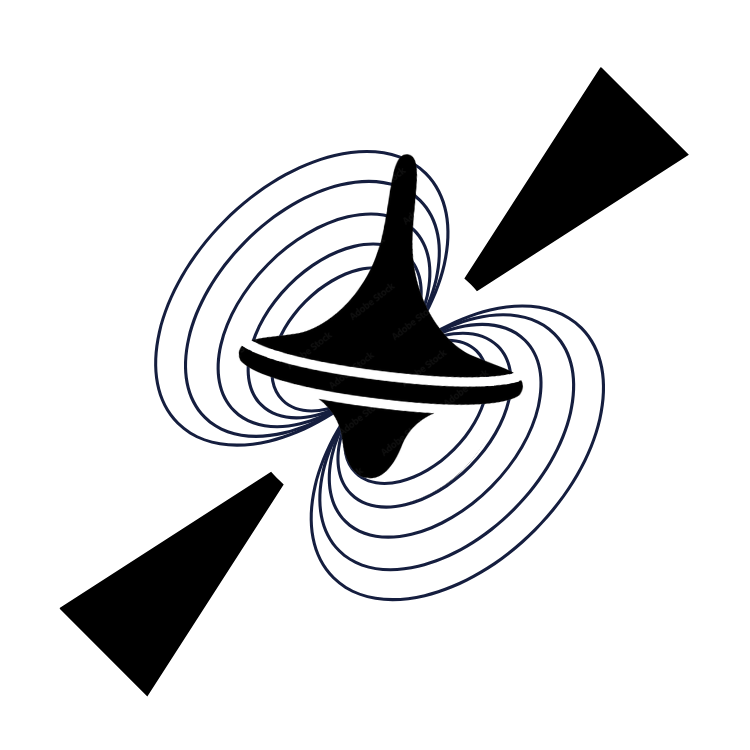

# **INCEPTION**

**IN**je**C**tion toolkit for pulsar s**E**arch **P**ipeline valida**TION**

INCEPTION injects realistic synthetic pulsars into real or synthetic SIGPROC filterbank data. The injected
pulsars are barycentred, dispersed, smeared within channels, scattered, Doppler shifted by binary orbits or
accelerations, and modulated by scintillation or eclipses. They are added below the quantisation level of
the data without changing its noise statistics, so the injected data can be processed by any search or
folding software.

| Part | Folder | What it does |
|---|---|---|
| Injector | `injector/` | The core library and the standalone script `SCRIPT_inject_pulsars.py`, with ready-to-run injection plans in `injector/example_plans/`. |
| Search Pipeline Validator | `search_pipeline_validator/` | Nextflow pipelines that inject many pulsars, fold them, search the data with PEASOUP or PRESTO, match the candidates to the injections and collect the results in one table. |
| Nullsar | `nullsar/` | A Nextflow pipeline that removes bright known pulsars from observations by injecting a calibrated negative copy of them. |

## Documentation

- **Humans:** read [INCEPTION_human_guide.pdf](INCEPTION_human_guide.pdf). It covers installation, the
  standalone injector and its injection plans, injecting known pulsars with PINT, how the signal is
  shaped, the Nextflow pipelines and Nullsar, with examples and figures.
- **AI agents:** read [INCEPTION_agent_guide.md](INCEPTION_agent_guide.md) in full before doing anything.
  It explains how to run every part of INCEPTION and which questions to ask the user before running it.

## Contact and citing

Questions and problems: Robert Senzel, rsenzel@mpifr-bonn.mpg.de.

If you use INCEPTION, the Search Pipeline Validator or Nullsar, please cite the INCEPTION paper
(Senzel et al., in prep.) and any software the pipelines call (PulsarX, PRESTO, DSPSR/PSRCHIVE, PEASOUP,
PINT, Astropy, Nextflow).

## Acknowledgement

INCEPTION is supported by [COMPACT](https://erc-compact.org/), an ERC Starting Grant project hosted at the
Max Planck Institute for Radio Astronomy.
